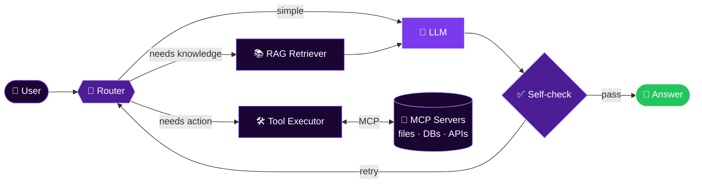

<div align="center">

<!-- ══ HERO HEADER ══ -->


<a href="https://git.io/typing-svg">
  
</a>

<br/>


<br/><br/>

[](https://www.linkedin.com/in/yashprataprai)
[](https://my-portfolio-kappa-one-29.vercel.app/)
[](mailto:yashpratapraiofficial@gmail.com)


</div>

<br/>

<!-- ══ ABOUT ══ -->
<div align="center">

## ✨ About Me

</div>

<table align="center">
<tr>
<td width="55%" valign="top">

I'm an aspiring **Data Scientist and ML Engineer** who likes taking a model from a notebook to something that actually does work.

Right now I'm going deep on **agentic AI**: LLM systems that reason, call tools, keep state, and recover from mistakes, built with **LangChain**, **LangGraph**, and the **Model Context Protocol (MCP)**.

- 🔭 Building stateful multi-step agents with **LangGraph**
- 🔌 Exposing data and tools to LLMs through **MCP**
- 📚 Designing **RAG** pipelines with retrieval evaluation
- 🧪 Applying **classical ML + deep learning** to NLP and prediction
- 🎯 Open to **ML Engineer / Data Scientist / GenAI** roles

</td>
<td width="45%" valign="top">

```python
class Yash:
    role = "ML Engineer"
    location = "India 🇮🇳"

    stack = [
        "LangChain", "LangGraph",
        "MCP", "RAG",
        "scikit-learn", "TensorFlow",
    ]

    focus = "Agents that reason, plan & act"

    def mission(self):
        return "Make models useful, then reliable."
```

</td>
</tr>
</table>

<br/>

<!-- ══ FOCUS CARDS ══ -->
<div align="center">

## 🎯 What I Work On

| 🕸️ LangGraph | 🔗 LangChain | 🔌 MCP | 🧪 Machine Learning |
|:---:|:---:|:---:|:---:|
| Stateful agent graphs | RAG pipelines | MCP servers & clients | scikit-learn models |
| Conditional routing | Retrievers & chains | Tool discovery | Deep learning with Keras |
| Loops & retries | Prompt templates | Standard tool interface | NLP & recommenders |
| Human-in-the-loop | Output parsing | Data and API access | Evaluation & tuning |

</div>

---

<!-- ══ ARCHITECTURE ══ -->
<div align="center">

## 🧩 The Kind of Agent I Build

</div>



---

<!-- ══ CODE SHOWCASE ══ -->
<div align="center">

## 💻 Code I'm Writing

</div>

<details open>
<summary><b>🕸️ LangGraph: retrieve → generate → verify loop</b></summary>

<br/>

```python
from typing import TypedDict
from langgraph.graph import StateGraph, END

class State(TypedDict):
    question: str
    context: str
    answer: str
    attempts: int

def retrieve(state: State) -> dict:
    docs = retriever.invoke(state["question"])          # LangChain retriever
    return {"context": "\n\n".join(d.page_content for d in docs)}

def generate(state: State) -> dict:
    prompt = f"Context:\n{state['context']}\n\nQuestion: {state['question']}"
    return {"answer": llm.invoke(prompt).content,
            "attempts": state.get("attempts", 0) + 1}

def verify(state: State) -> str:
    grounded = grader.invoke({"answer": state["answer"], "context": state["context"]})
    return "done" if grounded or state["attempts"] >= 3 else "retry"

graph = StateGraph(State)
graph.add_node("retrieve", retrieve)
graph.add_node("generate", generate)
graph.set_entry_point("retrieve")
graph.add_edge("retrieve", "generate")
graph.add_conditional_edges("generate", verify, {"done": END, "retry": "retrieve"})

app = graph.compile()
```

</details>

<details>
<summary><b>🔌 MCP: a small analytics server</b></summary>

<br/>

```python
from mcp.server.fastmcp import FastMCP
import pandas as pd

mcp = FastMCP("analytics-server")

@mcp.tool()
def describe_dataset(path: str) -> dict:
    """Return row count, columns, and dtypes for a CSV file."""
    df = pd.read_csv(path)
    return {"rows": len(df), "columns": list(df.columns),
            "dtypes": {c: str(t) for c, t in df.dtypes.items()}}

@mcp.tool()
def top_values(path: str, column: str, n: int = 5) -> dict:
    """Most frequent values in a column."""
    return pd.read_csv(path)[column].value_counts().head(n).to_dict()

if __name__ == "__main__":
    mcp.run()
```

Any MCP-compatible client can discover and call these tools without custom glue code.

</details>

---

<!-- ══ TECH STACK ══ -->
<div align="center">

## 🛠 Tech Stack


<br/><br/>


</div>

---

<!-- ══ PROJECTS ══ -->
<div align="center">

## 🚀 Featured Projects

| 🎬 Movie Recommendation System | 📝 LSTM Next Word Predictor | 📊 Power BI Dashboards |
|:--|:--|:--|
| Content-based filtering on **45K+ movies** | Deep learning NLP model for sequence prediction | Interactive dashboards for business insights |
| TF-IDF + Cosine Similarity | Stacked LSTM layers | KPI tracking & drill-downs |
| `Python` `scikit-learn` `Pandas` | `TensorFlow` `Keras` `Python` | `Power BI` `SQL` |

</div>

<br/>

<div align="center">

### 🧭 Agentic AI Roadmap

| Status | Project | Highlights |
|:--:|:--|:--|
| 🔨 | **RAG Q&A system** | LangChain, vector store, retrieval evaluation |
| 🔨 | **Multi-step research agent** | LangGraph state machine, search tool, citations |
| 🧪 | **MCP analytics server** | Datasets and charts exposed as MCP tools |
| 🧪 | **Human-in-the-loop agent** | LangGraph checkpoints, approval steps, memory |
| 📝 | **Agent evaluation harness** | Trace logging, regression tests for prompts and tools |

<sub>🔨 in progress &nbsp;·&nbsp; 🧪 prototyping &nbsp;·&nbsp; 📝 planned</sub>

</div>

---

<!-- ══ LEARNING PATH ══ -->
<div align="center">

## 🗺️ Learning Path

</div>


---

<!-- ══ STATS ══ -->
<div align="center">

## 📊 GitHub Stats


<br/>


<br/>


</div>

---

<!-- ══ CONTACT ══ -->
<div align="center">

## 🤝 Let's Build Something

I'm open to **ML Engineer, Data Scientist, and GenAI / Agentic AI** roles, and always up for a chat about LangGraph, MCP, or RAG.

<br/>

📫 [yashpratapraiofficial@gmail.com](mailto:yashpratapraiofficial@gmail.com) &nbsp;•&nbsp; 💼 [LinkedIn](https://www.linkedin.com/in/yashprataprai) &nbsp;•&nbsp; 🌐 [Portfolio](https://my-portfolio-kappa-one-29.vercel.app/)

<br/>


</div>
