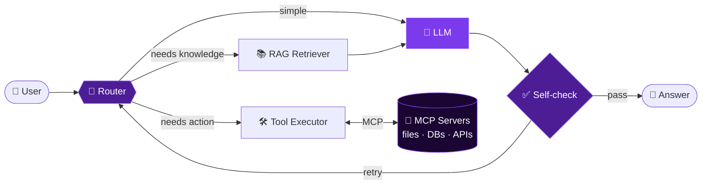

<div align="center">

<!-- ══ HEADER ══ -->


<!-- ══ TYPING ANIMATION ══ -->
<a href="https://git.io/typing-svg">
  
</a>

<br/><br/>

<!-- ══ STATUS BADGES ══ -->


<br/><br/>

<!-- ══ SOCIAL ══ -->
[](https://www.linkedin.com/in/yashprataprai)
[](https://my-portfolio-kappa-one-29.vercel.app/)
[](mailto:yashpratapraiofficial@gmail.com)


</div>

---

## 👋 Hey, I'm Yash

I'm an aspiring **Data Scientist and ML Engineer** who loves taking a model from a notebook to something that actually *does* work. These days I'm focused on **agentic AI**: building LLM systems that can reason, call tools, keep state, and recover from mistakes, using **LangChain**, **LangGraph**, and the **Model Context Protocol (MCP)**.

```python
class YashPratapRai:
    role = "Data Scientist & ML Engineer"
    location = "India 🇮🇳"

    core_ml     = ["scikit-learn", "TensorFlow / Keras", "NLP", "Feature Engineering"]
    llm_stack   = ["LangChain", "LangGraph", "HuggingFace", "OpenAI", "Mistral", "Gemini"]
    protocols   = ["Model Context Protocol (MCP)", "Tool / Function Calling"]
    retrieval   = ["RAG", "Embeddings", "Vector Databases"]
    cloud_bi    = ["Azure", "Power BI", "SQL"]

    currently   = "Building stateful multi-step agents and MCP-powered tools"
    philosophy  = "Data in, decisions out. Make the model useful, then make it reliable."

    def open_to(self):
        return ["ML Engineer", "Data Scientist", "GenAI / Agentic AI roles"]
```

---

## 🔭 What I'm Working On

| Area | What I'm doing | Stack |
|:--|:--|:--|
| 🕸️ **LangGraph agents** | Stateful graphs with conditional routing, loops, and human-in-the-loop checkpoints | LangGraph, LangChain |
| 🔌 **MCP servers & clients** | Exposing data and tools to LLMs through a standard protocol instead of one-off integrations | MCP Python SDK |
| 📚 **RAG pipelines** | Chunking, embeddings, retrieval, and evaluation for grounded Q&A | LangChain, FAISS / Chroma |
| 🧪 **Applied ML** | Classical ML + deep learning for prediction and NLP | scikit-learn, TensorFlow |
| 📊 **Analytics** | Dashboards that turn raw data into decisions | Power BI, SQL, Azure |

---

## 🧩 Agent Architecture I Build Towards



---

## 🕸️ LangGraph in Practice

A minimal stateful graph with a retrieve → generate → verify loop:

```python
from typing import TypedDict
from langgraph.graph import StateGraph, END

class State(TypedDict):
    question: str
    context: str
    answer: str
    attempts: int

def retrieve(state: State) -> dict:
    docs = retriever.invoke(state["question"])          # your LangChain retriever
    return {"context": "\n\n".join(d.page_content for d in docs)}

def generate(state: State) -> dict:
    prompt = f"Context:\n{state['context']}\n\nQuestion: {state['question']}"
    return {"answer": llm.invoke(prompt).content,
            "attempts": state.get("attempts", 0) + 1}

def verify(state: State) -> str:
    grounded = grader.invoke({"answer": state["answer"], "context": state["context"]})
    return "done" if grounded or state["attempts"] >= 3 else "retry"

graph = StateGraph(State)
graph.add_node("retrieve", retrieve)
graph.add_node("generate", generate)
graph.set_entry_point("retrieve")
graph.add_edge("retrieve", "generate")
graph.add_conditional_edges("generate", verify, {"done": END, "retry": "retrieve"})

app = graph.compile()
```

---

## 🔌 MCP: One Protocol, Many Tools

I'm exploring MCP as the standard way to plug data and tools into LLM apps. A small analytics server:

```python
from mcp.server.fastmcp import FastMCP
import pandas as pd

mcp = FastMCP("analytics-server")

@mcp.tool()
def describe_dataset(path: str) -> dict:
    """Return row count, columns, and dtypes for a CSV file."""
    df = pd.read_csv(path)
    return {"rows": len(df), "columns": list(df.columns),
            "dtypes": {c: str(t) for c, t in df.dtypes.items()}}

@mcp.tool()
def top_values(path: str, column: str, n: int = 5) -> dict:
    """Most frequent values in a column."""
    return pd.read_csv(path)[column].value_counts().head(n).to_dict()

if __name__ == "__main__":
    mcp.run()
```

Any MCP-compatible client (Claude Desktop, LangGraph agents via MCP adapters, IDEs) can discover and call these tools without custom glue code.

---

## 🛠 Tech Stack

<div align="center">

### 🤖 LLM · Agents · MCP


### 🧪 Machine Learning


### ☁️ Data · Cloud · BI


### 💻 Secondary


</div>

---

## 🚀 Featured Projects

<div align="center">

| 🎬 Movie Recommendation System | 📝 LSTM Next Word Predictor | 📊 Power BI Dashboards |
|:--|:--|:--|
| Content-based filtering on **45K+ movies** | Deep learning NLP model for sequence prediction | Interactive dashboards for business insights |
| TF-IDF + Cosine Similarity | Stacked LSTM layers | KPI tracking & drill-downs |
| `Python` `scikit-learn` `Pandas` | `TensorFlow` `Keras` `Python` | `Power BI` `SQL` |

</div>

### 🧭 Roadmap: Agentic AI Projects

| Status | Project | Highlights |
|:--:|:--|:--|
| 🔨 | **RAG Q&A system** | LangChain, vector store, retrieval evaluation |
| 🔨 | **Multi-step research agent** | LangGraph state machine, web search tool, citations |
| 🧪 | **MCP analytics server** | Expose datasets and charts as MCP tools |
| 🧪 | **Human-in-the-loop agent** | LangGraph checkpoints, approval steps, memory |
| 📝 | **Agent evaluation harness** | Trace logging, regression tests for prompts and tools |

<sub>🔨 in progress · 🧪 prototyping · 📝 planned</sub>

---

## 🗺️ Learning Path


---

## 📊 GitHub Stats

<div align="center">


<br/>


<br/>


</div>

---

## 🤝 Let's Connect

I'm open to **ML Engineer, Data Scientist, and GenAI / Agentic AI** roles, and always happy to talk about LangGraph, MCP, or RAG.

<div align="center">

📫 **[yashpratapraiofficial@gmail.com](mailto:yashpratapraiofficial@gmail.com)** &nbsp;·&nbsp; 💼 **[LinkedIn](https://www.linkedin.com/in/yashprataprai)** &nbsp;·&nbsp; 🌐 **[Portfolio](https://my-portfolio-kappa-one-29.vercel.app/)**

<br/>


</div>
